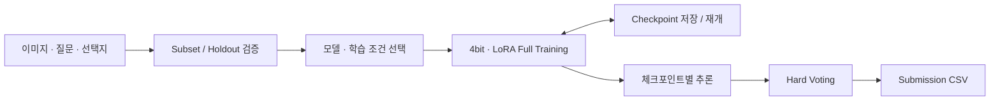

# SSAFY AI Challenge · 재활용품 VQA

**제한된 GPU와 6일의 일정 안에서 멀티모달 모델을 비교·학습하고, 재활용품 이미지 질문의 정답을 예측한 프로젝트입니다.**

이미지와 자연어 질문, 네 개의 선택지를 입력받아 `a / b / c / d` 중 정답을 선택합니다. 작은 데이터로 후보를 먼저 검증한 뒤 최종 모델을 전체 학습 데이터로 학습하고, 여러 체크포인트의 예측을 Hard Voting으로 결합했습니다.

| 항목 | 내용 |
| --- | --- |
| 대회 | 2026 SSAFY 15기 2회차 AI 챌린지 |
| 기간 | 2026.04.01 ~ 2026.04.06 |
| 팀 | 4명 |
| 담당 | 윤광혁 · 팀원 모집 / 팀장 / 모델 실험 / 최종 모델 선정 |
| 과제 | 재활용품 이미지 기반 4지선다 Visual Question Answering |
| 결과 | 192팀 중 7위 · 참가 당시 확인 기록 기준 |

## 문제 해결 과정

1. **GPU·시간을 기준으로 실험 범위를 정했습니다.** 두 명은 모델 실험, 두 명은 데이터 수집·전처리·증강을 담당하도록 작업을 나눴습니다.
2. **부분 데이터와 holdout 검증으로 후보를 압축했습니다.** 모든 후보를 전체 데이터로 학습하는 대신, 빠른 검증에서 가치가 확인된 모델과 설정을 우선했습니다.
3. **Qwen3-VL-32B 4bit 계열을 최종 모델로 선택했습니다.** 4bit 양자화와 LoRA를 활용해 모델을 학습했습니다.
4. **중단된 학습을 이어갈 수 있도록 저장·재개 구조를 갖췄습니다.** 모델, optimizer, scheduler, scaler와 epoch·step 상태를 함께 저장합니다.
5. **체크포인트 예측을 Hard Voting으로 결합했습니다.** 제출 마감과 추론 비용을 고려해 다수결 기반 앙상블을 최종 제출에 적용했습니다.

## 제가 맡은 일

- 팀원 모집과 역할 분담, GPU 사용·실험 우선순위·일정 관리
- 모델 성능 비교를 위한 검증 코드 마련과 후보 탐색, 최종 모델 선정
- epoch·learning rate 등 학습 조건 비교와 full training 진행
- 체크포인트 저장·재개 및 추론·제출 과정 관리
- 여러 체크포인트의 답변 차이를 바탕으로 Hard Voting 전략 선택·적용

Colab에서 진행한 팀 프로젝트로, 이 공개 저장소의 커밋은 당시 개발 이력이 아닌 공개용 정리 이력입니다. 개인 담당 범위는 참가 과정에서 확인한 역할을 기준으로 작성했습니다.

## 기술 구성

| 영역 | 기술 |
| --- | --- |
| 모델 | Qwen2.5-VL-3B baseline, Qwen3-VL-32B 4bit 최종 모델 |
| 학습 | Python, PyTorch, Unsloth, Transformers, PEFT / LoRA, bitsandbytes |
| 데이터 | pandas, NumPy, Pillow, scikit-learn |
| 실행 환경 | Google Colab, CUDA GPU, Google Drive 체크포인트 저장 |
| 추론·결합 | 선택지 점수 기반 추론 / 생성 기반 추론, Hard Voting |

## 코드 둘러보기

| 파일 | 내용 |
| --- | --- |
| [baseline_colab.ipynb](notebooks/baseline_colab.ipynb) | Qwen2.5-VL-3B 기반 초기 학습·추론 baseline |
| [final_training.ipynb](notebooks/final_training.ipynb) | 모델 선택 설정, 4bit·LoRA 학습, holdout/full-train, 체크포인트 저장·재개, 제출·앙상블 |
| [실험과 결과](docs/EXPERIMENTS.md) | 실험 전략, 확인된 성과, 코드 기본값과 참가 기록 구분 |
| [데이터 준비](docs/DATA.md) | CSV 스키마, 데이터 규모, 이미지 경로와 제출 형식 |

## Colab에서 실행하기

1. `notebooks/final_training.ipynb`를 Colab에 열고 CUDA GPU 런타임을 선택합니다. 32B 모델은 큰 GPU 메모리가 필요하므로 실행 환경에 맞는 모델을 선택하세요.
2. 첫 설치 셀은 원본에서 주석 처리되어 있습니다. PyTorch·CUDA 환경을 확인한 후 필요한 설치 명령의 주석을 해제하고 실행합니다. 설치 후 런타임을 한 번 재시작합니다.
3. Drive를 연결하고 정식으로 제공받은 대회 데이터를 준비합니다.
4. `CFG`의 `data_zip_path`, `data_root`, `output_root`, `model_key`를 본인 환경에 맞게 설정합니다.
5. 먼저 subset 또는 holdout 모드로 검증한 뒤 full training과 제출 CSV 생성을 실행합니다.

`train_on_full_data=True`일 때는 별도의 holdout 검증을 수행하지 않습니다. 자동으로 추가 학습을 반복하는 `DO_FULL_TRAIN_ROUNDS`는 기본적으로 꺼져 있습니다. 자세한 설정과 기본값은 [실험 문서](docs/EXPERIMENTS.md)를 확인하세요.

## 공개 범위

학습·추론 노트북과 실험 설명을 공개했습니다. 대회 원본 데이터·이미지, 학습 가중치, 제출 결과 파일은 포함하지 않으며 노트북의 실행 출력과 개인 메타데이터는 제거했습니다. 모델을 재학습하려면 별도로 확보한 데이터와 GPU 환경이 필요합니다.
